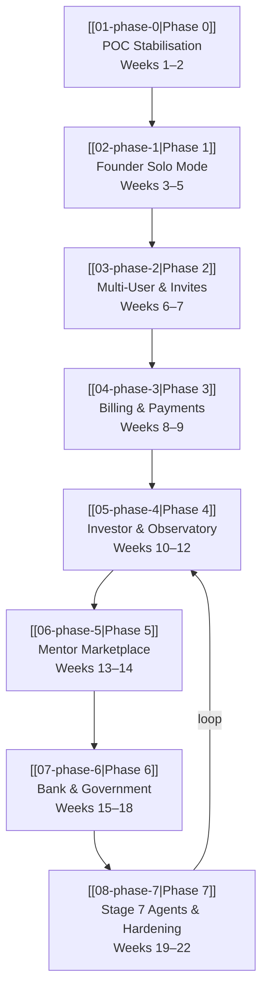

# Digi Incubator — Phased Build Plan

> [!important] How to read this
> Every phase file integrates the **inversion analysis findings** directly into the steps. You will not find a separate "fixes to apply" list — each fix is embedded as a mandatory step in the phase where it must be done. Steps marked `[!danger]` are inversion-identified failure modes that were absent from the original plan.

---

## Phase Map



---

## Phase Summary

| Phase                   | Name                       | Duration    | Key Unlock                                |
| ----------------------- | -------------------------- | ----------- | ----------------------------------------- |
| [[01-phase-0\|Phase 0]] | POC Stabilisation          | Weeks 1–2   | Multi-tenant schema foundation            |
| [[02-phase-1\|Phase 1]] | Founder Solo Mode          | Weeks 3–5   | AI agents live, freemium gated            |
| [[03-phase-2\|Phase 2]] | Multi-User & Invites       | Weeks 6–7   | Team startups, run attribution            |
| [[04-phase-3\|Phase 3]] | Billing & Payments         | Weeks 8–9   | Paid plans, Razorpay live                 |
| [[05-phase-4\|Phase 4]] | Investor & Observatory     | Weeks 10–12 | Two-sided platform, deal pipeline         |
| [[06-phase-5\|Phase 5]] | Mentor Marketplace         | Weeks 13–14 | Commission revenue, Stream 4              |
| [[07-phase-6\|Phase 6]] | Bank & Government          | Weeks 15–18 | Enterprise contracts, loan pipeline       |
| [[08-phase-7\|Phase 7]] | Stage 7 Agents & Hardening | Weeks 19–22 | Retention loop, RLS, production hardening |

---

## Inversion Amendments — Quick Reference

These are the findings from the inversion analysis that changed the original plan. Each is applied in the phase file it belongs to.

| Amendment                    | Original Plan      | After Inversion                         | Applied In              |
| ---------------------------- | ------------------ | --------------------------------------- | ----------------------- |
| POC data audit               | Backfill directly  | Audit rows first                        | [[01-phase-0\|Phase 0]] |
| `subscriptions` table        | Create in Phase 3  | Create in Phase 0, seed as `free`       | [[01-phase-0\|Phase 0]] |
| Soft deletes (`deleted_at`)  | Phase 7            | Phase 0, before any data                | [[01-phase-0\|Phase 0]] |
| `agent_version` column       | Phase 7            | Phase 0, on schema creation             | [[01-phase-0\|Phase 0]] |
| `TenantContext` dataclass    | Convention only    | Typed enforcement from Phase 0          | [[01-phase-0\|Phase 0]] |
| LangGraph checkpointing      | Not planned        | `core/graph_store.py` from Phase 1      | [[02-phase-1\|Phase 1]] |
| `workers/` module            | Phase 3            | Phase 1 — first agent needs it          | [[02-phase-1\|Phase 1]] |
| Fire-and-poll async          | Not planned        | All agents from Phase 1 day one         | [[02-phase-1\|Phase 1]] |
| Multi-user UI constraints    | Phase 2            | 4 constraints baked into Phase 1 UI     | [[02-phase-1\|Phase 1]] |
| `core/llm.py` as factory     | Single client      | Factory function per agent task type    | [[02-phase-1\|Phase 1]] |
| Route classification folders | Flat `api/routes/` | `public/` `anonymous/` `authenticated/` | [[02-phase-1\|Phase 1]] |
| Observatory 50-startup gate  | Assumed sufficient | Hard prerequisite count before launch   | [[05-phase-4\|Phase 4]] |
| Audit log table              | Phase 6            | Phase 4 — needed for enterprise sales   | [[05-phase-4\|Phase 4]] |

---

## Folder Structure (Final — post-inversion)

```
app/
├── api/
│   ├── public/              ← No auth, no tenant (Observatory, health, invite link)
│   ├── anonymous/           ← session_id only (pre-signup idea capture)
│   └── authenticated/       ← Full TenantContext required
│       ├── founder/
│       ├── investor/
│       ├── mentor/
│       ├── bank/
│       └── govt/
├── agents/
│   ├── base_agent.py
│   ├── context/             ← Read-only data access layer for graphs
│   │   └── agent_context.py
│   ├── market_research/
│   ├── conviction_scorer/
│   ├── lean_canvas/
│   ├── gtm/
│   ├── financial_projections/
│   └── market_sizing/
├── workers/                 ← Celery / Azure Service Bus consumers
│   ├── agent_worker.py
│   └── payout_worker.py
├── services/
│   ├── agent_service.py
│   ├── startup_service.py
│   ├── billing_service.py
│   └── discovery_service.py
├── repositories/            ← All DB queries — every fn takes TenantContext
│   ├── startup_repo.py
│   ├── planning_repo.py
│   └── subscription_repo.py
├── middleware/
│   ├── tenant_middleware.py
│   └── observatory_middleware.py
└── core/
    ├── llm.py               ← Factory function, not singleton
    ├── storage.py           ← Azure Blob + enforced key convention
    ├── queue.py             ← Job queue client (Celery/Service Bus)
    └── graph_store.py       ← LangGraph PostgreSQL checkpointer
```

---

## Standing Decisions

| Decision | Status |
|---|---|
| Org-as-tenant for all org-based personas | ✅ Confirmed |
| Row-level isolation (not schema-per-tenant) | ✅ Confirmed |
| Sequential persona switching | ✅ Confirmed |
| Mentor uses `user_id` as tenant | ✅ Confirmed |
| Observatory opt-in always free for founders | ✅ Confirmed |
| Subscriptions table seeded `free` at signup | ✅ Added by inversion |
| All agent runs are fire-and-poll (async) | ✅ Added by inversion |
| `TenantContext` dataclass required by all repos | ✅ Added by inversion |

---

*Last updated: 2026-04-14 · Digi Incubator platform team*
